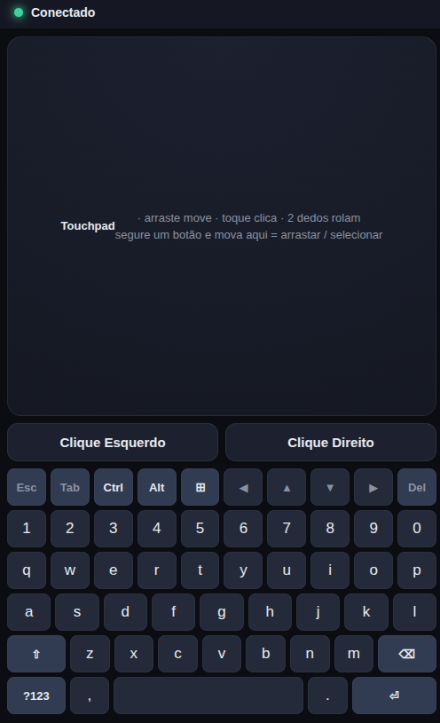
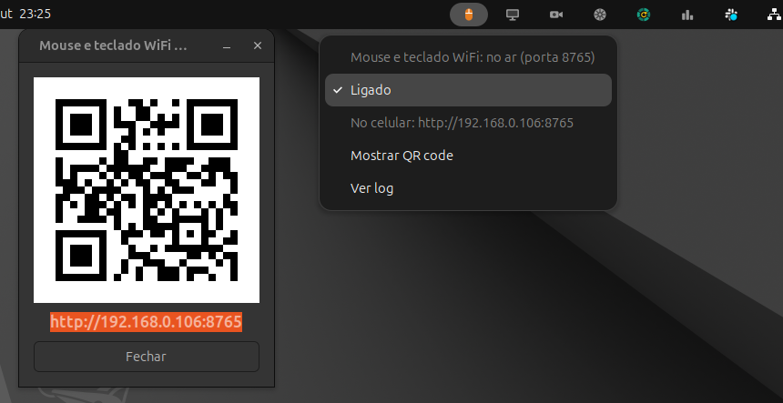

<div align="center">

# LAN Mouse & Keyboard

**The phone becomes the PC's mouse and keyboard over the local network, by opening one address in the browser.**


[](https://github.com/gabrielogregorio/devkit-lan-mouse-keyboard/actions/workflows/tests.yml)
[](https://github.com/gabrielogregorio/devkit-lan-mouse-keyboard/actions/workflows/check-quality.yml)
[](https://github.com/gabrielogregorio/devkit-lan-mouse-keyboard/actions/workflows/codeql-analysis.yml)

<br>



</div>

## About

Control the **mouse and keyboard** of an Ubuntu PC from a phone (or any device with a browser) on
the local network. The PC serves a web page; the phone opens it and sends touch and key commands
over a WebSocket; the PC injects them through `/dev/uinput`. **No app, no password, no login.**

> **Same network required.** The phone and the PC must be on the same local network (same Wi-Fi or
> the same router, cable counts). The page is reached by the PC's local IP
> (`http://<pc-ip>:8765`); nothing goes through the internet, so it does not work from another
> network or over mobile data. A guest Wi-Fi with client isolation also blocks it.

- 🖱️ **Touchpad:** drag moves, tap clicks, 2 fingers scroll, a 2 finger tap is a right click.
  Hold a click button with one finger and move another on the pad to drag or select.
- ⌨️ **Full keyboard on the page** (QWERTY + symbols + arrows) with Ctrl, Alt, Super, Esc, Tab and
  Del, real shortcuts (Ctrl+C, Ctrl+Alt+T, Alt+Tab), portrait and landscape.
- 🔒 **Local network only:** non-private IPs get HTTP **403** and the WebSocket closed. The service
  only *receives* commands; nothing is sent back.
- 🔔 **Ubuntu notification** for every new connected device; 📌 **tray icon** with the status.
- 🐧 Works the same on **X11 and Wayland** (kernel-level input).
- 🌐 **Language:** the page follows the browser (`pt*` shows Brazilian Portuguese, anything else
  English; force one with `?lang=en` or `?lang=pt-BR`); the tray menu and notifications follow the
  system language.

Built and tested on Ubuntu 24.04.

## Set up on a new PC

1. **Install** (asks for sudo: `python3-venv`, `python3-gi`, AppIndicator, `libnotify-bin`, the
   `/dev/uinput` udev rule, the venv and the systemd user service):
   ```bash
   git clone <repo-url> devkit-lan-mouse-keyboard
   cd devkit-lan-mouse-keyboard
   ./install.sh                # service installed, off at login
   ./install.sh --autostart    # or: start it with every session
   ```
2. **Log out and back in** the first time: the install adds you to the `input` group, which is what
   keeps `/dev/uinput` writable after a reboot.
3. **Start and use:**
   ```bash
   systemctl --user start lan-mouse-keyboard    # or ./run.sh in the foreground
   ```
   On the phone, open the address printed at the end of `install.sh` (`http://<pc-ip>:8765`).
4. **Top bar icon (optional):** `./tray_icon.py --install` puts an icon on the top bar at every
   login, gray while off. Its menu turns the server on and off; turning it on opens a QR code with
   the address, so the phone does not need it typed (it starts the server with `LMK_NO_TRAY=1`, so the server's own status icon stays hidden):

   

   The menu follows the system language (the screenshot is in Brazilian Portuguese: Ligado = On,
   Mostrar QR code = Show QR code). The address is the PC's local IP, so the QR code only works on
   the same network. The QR code needs `sudo apt install python3-segno`; without it the window
   shows only the address. `./tray_icon.py --remove` takes the icon out of the login.

**Outside the repository:**

| Path | What |
|---|---|
| `venv/` | Python venv (`--system-site-packages` for PyGObject), ignored by git |
| `~/.config/systemd/user/lan-mouse-keyboard.service` | systemd user service (stores the folder path) |
| `/etc/udev/rules.d/99-lan-mouse-keyboard.rules` | `/dev/uinput` owned by the `input` group, mode 0660 |
| `/etc/modules-load.d/uinput.conf` | loads `uinput` at boot |

Moved the folder? Run `./install.sh` again (the service and the venv store the path; move `venv/`
to `trash/` first so it is recreated).

## Available scripts

```bash
# Run
./run.sh                                        # foreground (Ctrl+C stops it)
systemctl --user start lan-mouse-keyboard       # as a service
systemctl --user status lan-mouse-keyboard
journalctl --user -u lan-mouse-keyboard -f      # logs
LMK_PORT=9000 ./run.sh                          # another port

# Install / remove
./install.sh                # service installed, off at login
./install.sh --autostart    # starts with the session
./uninstall.sh

# Top bar icon (on/off, QR code), at every login
./tray_icon.py --install
./tray_icon.py --remove

# Test (never opens /dev/uinput: nothing moves your mouse)
./run-tests.sh                                   # lint + backend + frontend i18n (~3 s)
(cd tests/frontend && npm ci && npx playwright install chromium-headless-shell)
RUN_E2E=1 ./run-tests.sh                         # + Playwright E2E

# Dependencies (uv)
uv lock && uv export --frozen --no-dev --no-emit-project --no-hashes -o requirements.txt
```

## Tests

| Kind | Where | What it covers |
|---|---|---|
| **Lint** | `pyproject.toml` (ruff), ShellCheck | Python style, import order, bug patterns; warnings in every `.sh` |
| **Backend** | `tests/test_*.py` (pytest) | key maps and every uinput event written (fake `UInput`), the WebSocket protocol dispatch, the local network guard (403 / close 1008), bind watchdog, connect counter, tray headless path, i18n catalog |
| **Frontend** | `tests/frontend/i18n.test.mjs` (`node:test`) | every page string has its pt-BR line with the same `{placeholders}`, no unused line, language detection |
| **E2E** | `tests/frontend/e2e/` (Playwright, Pixel 5 viewport) | the real page with a fake WebSocket: connection and reconnect, touchpad gestures, hold buttons and multitouch drag, keyboard layers, modifiers and shortcuts, repeat on hold, portrait/landscape without horizontal scroll, English and pt-BR |

`./run-tests.sh` prints a scoreboard and skips what is not installed (ShellCheck:
`sudo apt install shellcheck`), saying so. The E2E runs in English (`locale: en-US`).

## CI/CD

GitHub Actions, in `.github/`:

| Workflow | When | What |
|---|---|---|
| `tests.yml` | push/PR to `main`, manual | unit layers (lint, backend, frontend), then the E2E with Playwright; the Playwright report is uploaded when it fails |
| `check-quality.yml` | push/PR to `main` | ruff, ShellCheck, JavaScript syntax, `.sh` files executable in git, actions pinned to a hash, workflow YAML |
| `codeql-analysis.yml` | push/PR, weekly | CodeQL for Python, JavaScript/TypeScript and the workflows |
| `auto-complete-fields.yml` | PR opened/updated | assigns the author, labels by commit words and touched files, lists the commits in the PR body (`[...autoGenerate]`), titles it `Release vX.Y.Z - …`, fails if that version was already released |
| `create-tag-and-release.yml` | PR merged into `main` | creates the tag `vX.Y.Z` from `VERSION` and a GitHub release with the PR text, generated notes, the source tarball and `SHA256SUMS` (a `-rc.1` style version becomes a pre-release) |

`setup-environment` (composite action) sets up Node, creates the venv from `requirements-dev.txt`
and, for the E2E, runs `npm ci` in `tests/frontend` and installs Chromium.

**Pinned versions.** Every third-party action is pinned to the full commit hash of its release tag,
with the version as a comment, so a moved or hijacked tag cannot change what runs:

| Action | Version | Commit |
|---|---|---|
| `actions/checkout` | v6.1.0 | `d23441a48e516b6c34aea4fa41551a30e30af803` |
| `actions/setup-node` | v7.1.0 | `949feb2413d6458794dcd2491c4babbbce0c15c1` |
| `actions/upload-artifact` | v6.0.0 | `b7c566a772e6b6bfb58ed0dc250532a479d7789f` |
| `actions/github-script` | v8.0.0 | `ed597411d8f924073f98dfc5c65a23a2325f34cd` |
| `github/codeql-action` (init, analyze) | v4.39.1 | `9b3254085494b55a0f7c4c2b3d2d52cc712ce370` |

The rest is pinned too: runners on `ubuntu-24.04` (not `ubuntu-latest`), Node 22, Python packages
from `uv.lock` (through `requirements-dev.txt`, ruff included) and `@playwright/test` 1.62.0 from
`tests/frontend/package-lock.json`. `check-quality.yml` fails if a `uses:` is not a 40-character
hash (local `./` actions excepted). Dependabot opens a monthly PR that bumps the hash and the
comment together. To pin one by hand:

```bash
git ls-remote --tags https://github.com/actions/setup-node.git 'v7.1.0^{}' 'v7.1.0'   # the ^{} line, when present, is the commit
```

### Releasing

1. In the PR, bump `VERSION` (semver: `1.1.0`, or `1.1.0-rc.1` for a pre-release).
2. Merge into `main`. The tag and the release are created on their own.

What the release is built from:

| Part | Source |
|---|---|
| Tag | `v` + `VERSION` at the merge commit, pointing at that commit |
| Title | `LAN Mouse & Keyboard vX.Y.Z` |
| Notes | the PR title (without the `Release vX.Y.Z - ` prefix), then the PR body with the commit list that `auto-complete-fields.yml` filled in (the `[...autoGenerate]` marker is removed), then GitHub's generated notes (merged PRs, contributors, "Full Changelog" link to the previous tag) |
| Files | `devkit-lan-mouse-keyboard-X.Y.Z.tar.gz` (`git archive` of the merge commit: only tracked files) and `SHA256SUMS` |
| Type | a version with `-` (e.g. `1.1.0-rc.1`) is a pre-release; any other becomes "latest" |

If the tag already exists (the PR did not bump `VERSION`), nothing is released and the run leaves a
warning. The PR check `VERSION is new` catches that before the merge.

Issues use forms (`bug_report.yml`, `feature_request.yml`); PRs start from `pull_request_template.md`.

## Usage

1. Start the server on the PC (`systemctl --user start lan-mouse-keyboard` or `./run.sh`).
2. **On the phone** (on the **same network** as the PC): open `http://<pc-ip>:8765` (or scan the QR
   code from the top bar icon). The dot turns green with **Connected** and the PC shows a notification.
3. Drag on the touchpad to move, tap to click, use 2 fingers to scroll. For a shortcut, tap the
   modifiers (they stay highlighted) and then the key: **Ctrl** then **c** = Ctrl+C.

## Architecture

```
[Phone] browser → http://<pc-ip>:8765 → web/ (index.html, app.js, i18n.js)
        touch/keys → JSON over WebSocket /ws
                          │
[PC]    FastAPI (server/web.py): local IPs only (403 / close 1008)
                          │ asyncio.to_thread
        InputController (server/input_device.py): evdev UInput → /dev/uinput
                          │
        kernel input device "lan-mouse-keyboard" → X11 or Wayland session

        server/main.py: uvicorn thread + bind watchdog + tray/notifications (GTK main loop)
```

WebSocket messages (client → server only): `m` move, `s` scroll, `c` click, `d`/`u` button
press/release, `k` type text, `key` named key, `combo` modifiers + key. The full table is in
`CLAUDE.md`.

## Project layout

```
server/main.py           entry point: device, server thread, bind watchdog, callbacks
tray_icon.py             top bar icon: turns the server on and off, QR code, --install for the login
server/input_device.py   virtual mouse + keyboard over uinput, US key map
server/web.py            FastAPI: static page, /ws, local network guard
server/tray.py           tray icon (AppIndicator) + notify-send
server/i18n.py           tray and notification strings (en / pt-BR)
web/                     the phone page: index.html, style.css, app.js (ES module), i18n.js
tests/                   pytest (fake uinput) + frontend/ (node:test i18n, Playwright e2e/)
install.sh uninstall.sh  system setup and removal
run.sh run-tests.sh      foreground run, test runner
docs/                    README screenshots
.github/                 workflows, composite action, issue forms, PR template
```

Adding text: on the page, write it in English, either as `t("…")` in `app.js` or as the content
of an element with `data-i18n` (`data-i18n-html` when it has markup), and add the pt-BR line to
`PT_BR` in `web/i18n.js`. For the tray and notifications, wrap it in `tr("…")` and add the line to
`PT_BR` in `server/i18n.py`. The tests fail if a line is missing, if the `{placeholders}` differ or
if a pt-BR line is no longer used. Logs are English only.

## Dependencies

`pyproject.toml` declares, `uv.lock` locks, the `requirements*.txt` files are **exports of the lock**.
`install.sh` creates the venv from `requirements.txt`; for the tests add the dev file:

```bash
venv/bin/pip install -r requirements-dev.txt   # never a global pip (PEP 668)
```

After changing `pyproject.toml`, lock and export again:

```bash
uv lock
uv export --frozen --no-dev      --no-emit-project --no-hashes -o requirements.txt
uv export --frozen --all-groups  --no-emit-project --no-hashes -o requirements-dev.txt
```

## Settings

| Variable | Default | What |
|---|---|---|
| `LMK_PORT` | `8765` | HTTP/WebSocket port (for the service, `LMK_PORT=9000 ./install.sh`) |
| `LMK_HOST` | `0.0.0.0` | bind interface |
| `LMK_NO_TRAY` | unset | `1` = no own tray icon (another launcher shows one) |
| `LMK_LANG` | unset | `en` or `pt-BR` for the tray and notifications (default: system language) |

Pointer speed, tap time and scroll step are constants at the top of the touchpad section in
`web/app.js` (`SENS`, `TAP_MS`, `TAP_MOVE`, `SCROLL_DIV`).

## Limitations

- **Same local network only.** The phone reaches the PC by its LAN IP; another network, mobile data
  or a Wi-Fi with client isolation does not work.
- **Trusted network only.** There is no password: anyone on the same LAN who opens the address can
  control the PC. Do not expose the port to the internet.
- **US keyboard layout.** Text is typed as US QWERTY key presses; accents and other layouts are not
  supported, and unmapped characters are skipped.
- The keyboard is the on-screen one; the phone's own keyboard is not used.
- Needs write access to `/dev/uinput` (the `input` group from `install.sh`).

## License

[MIT](LICENSE). Use, copy, modify and distribute freely; the software is provided "as is", without
warranty of any kind.
